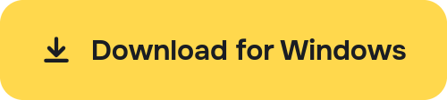
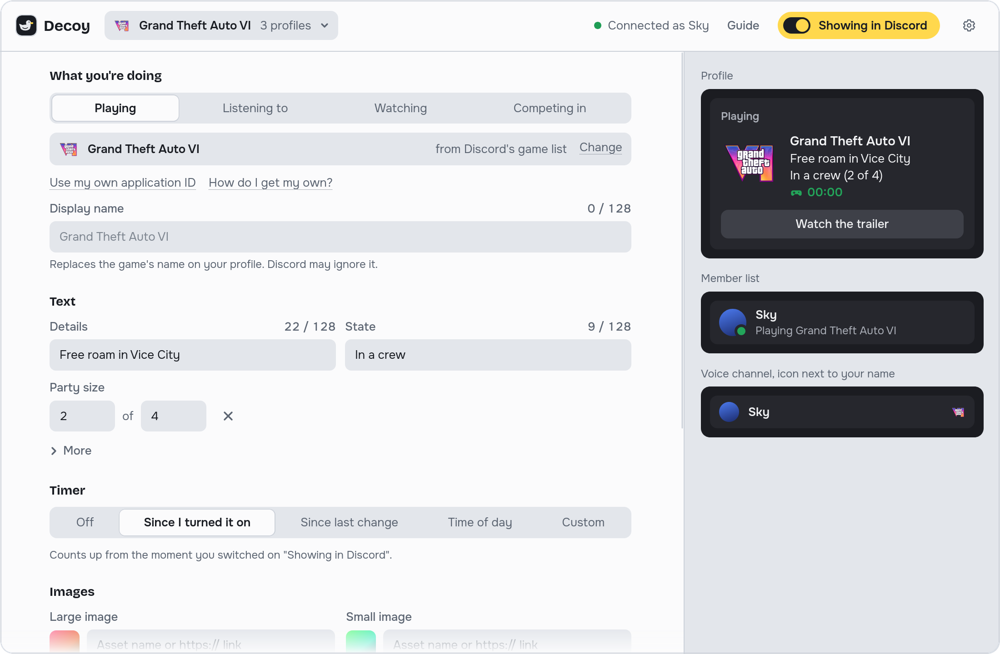
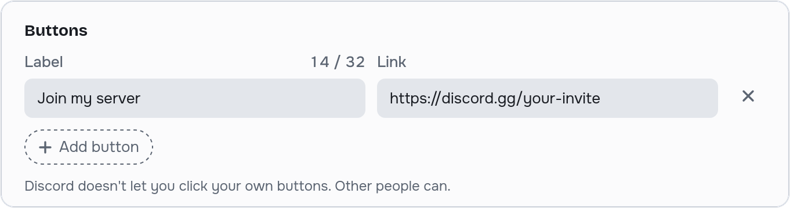

  

<h1 align="center">Decoy</h1>

  <b>Show anything you want as your Discord status.</b> 
  A game you are not playing, a button that leads to your server, your stream, your own picture and text. 
  Free and small. No account, no password, no coding.

  
  &nbsp;
  
  &nbsp;
  

  Windows 10 and 11, macOS 10.15 or newer, most Linux systems. <a href="#install">Install help and other files</a>

  <picture>
    <source media="(prefers-color-scheme: dark)" srcset="docs/window-dark.png">
    
  </picture>

## What your friends see

  

These are pieces of a real Discord window, with the name and avatar hidden. Your status shows up on your profile, in the member list, and as a small icon next to your name in voice channels.

## What people use it for

  

- **Look busy.** Pick any of about 25,000 games Discord knows. Your status looks exactly as if you were playing it.
- **Invite people to your server.** Put a button on your profile that opens your invite link. [Here is how](#add-a-link-to-your-server).
- **Share what you are into.** A stream, a playlist, a YouTube channel, your website: any link can be a button.
- **Make it yours.** Your own name, picture and text instead of a game. A guide inside Decoy shows how, step by step.

## Get started

1. **Download Decoy** with a button above and open it. The first time, Windows or macOS may ask whether you trust it: [what to press](#install).
2. **Pick a game.** Start typing its name and choose it from the list.
3. **Write your text**, if you want: two lines, a timer, a button. The preview on the right shows what others will see.
4. **Switch on "Showing in Discord"** at the top right. That's it.

Discord has to be open on the same computer (the app, not the website). You can close the Decoy window: it keeps running in the tray, next to the clock.

## Add a link to your server

  <picture>
    <source media="(prefers-color-scheme: dark)" srcset="docs/buttons-dark.png">
    
  </picture>

1. In Discord, open your server, click its name at the top and choose **Invite People**. Click **Edit invite link**, set it to never expire, and copy the link.
2. In Decoy, scroll down to **Buttons** and press **Add button**.
3. In **Label**, write what the button should say, for example `Join my server`. In **Link**, paste your invite.
4. Make sure **Showing in Discord** is on.

Good to know:

- You cannot click your own button. Discord only lets other people click it, so ask a friend to check.
- You can have two buttons. Any link that starts with `https://` works: a server invite, Twitch, YouTube, your website.
- Want your server's name and logo instead of a game? Press **Guide** in Decoy, then **Own app**. It is free and takes about five minutes.

## Install

| Your computer | Download | The first time you open it |
|---|---|---|
| Windows 10 and 11 | [Download .exe](https://github.com/mountain-beaver/decoy/releases/latest/download/Decoy-windows-x64-setup.exe) | Windows may say "Windows protected your PC". Press **More info**, then **Run anyway**. |
| Mac (Intel and Apple Silicon) | [Download .dmg](https://github.com/mountain-beaver/decoy/releases/latest/download/Decoy-darwin-universal.dmg) | Drag Decoy into Applications. If macOS says it cannot check the app, open **System Settings**, **Privacy & Security**, scroll down and press **Open Anyway**. |
| Linux, any | [Download .AppImage](https://github.com/mountain-beaver/decoy/releases/latest/download/Decoy-linux-amd64.AppImage) | Allow the file to run (`chmod +x`), then open it. |
| Debian, Ubuntu, Mint | [Download .deb](https://github.com/mountain-beaver/decoy/releases/latest/download/Decoy-linux-amd64.deb) | `sudo apt install ./Decoy-linux-amd64.deb` |
| Fedora, openSUSE | [Download .rpm](https://github.com/mountain-beaver/decoy/releases/latest/download/Decoy-linux-x86_64.rpm) | `sudo dnf install ./Decoy-linux-x86_64.rpm` |

**Why do Windows and macOS show a warning?** They warn about every app whose maker has not paid Microsoft or Apple for a certificate, and Decoy is a free project that has not. The installers are built automatically from the code in this repository, which anyone can read.

All versions are on the [Releases](https://github.com/mountain-beaver/decoy/releases) page.

## Questions

**Is it free?** 
Yes. No ads, no paid version.

**Is it safe for my account?** 
Decoy never asks for your Discord password and does not log in to your account. It tells the Discord app on your computer what to show, the same way games do.

**Do I have to keep it open?** 
Decoy has to be running, but you can close its window: it stays in the tray. To start it together with your computer, open **Settings** (the gear) and switch on **Start with my computer**.

**Does it work on a phone or in the browser?** 
Decoy runs on a computer, next to the Discord desktop app. People on phones will still see your status.

**Nothing shows up in Discord. What do I check?**
1. The Discord desktop app is running on the same computer.
2. In Discord, **User Settings**, **Activity Privacy**: sharing your activity is switched on.
3. Your status is not **Invisible**.

There is a longer checklist inside Decoy: **Guide**, then **Not showing**.

**Can I have more than one status?** 
Yes. Make several profiles and switch between them in the window or from the tray icon.

**Can I change the name after "Playing"?** 
Yes, with your own application: **Guide**, then **Own app**.

## Privacy

Decoy has no account, no analytics and no server of its own. Your profiles are saved only on your computer.

It connects to the internet for two things: to Discord, to load the game list, names and pictures, and to GitHub, at most twice a day, to see whether a newer version exists. It only shows you a link and never downloads anything by itself. You can switch that check off in **Settings**.

## For developers

Decoy is open source under the [MIT license](LICENSE). How it works inside, how to build it and how to run the checks: [docs/DEVELOPMENT.md](docs/DEVELOPMENT.md).

Decoy is not affiliated with Discord or any game publisher. Game names and icons, including the ones in the pictures above, belong to their owners.
