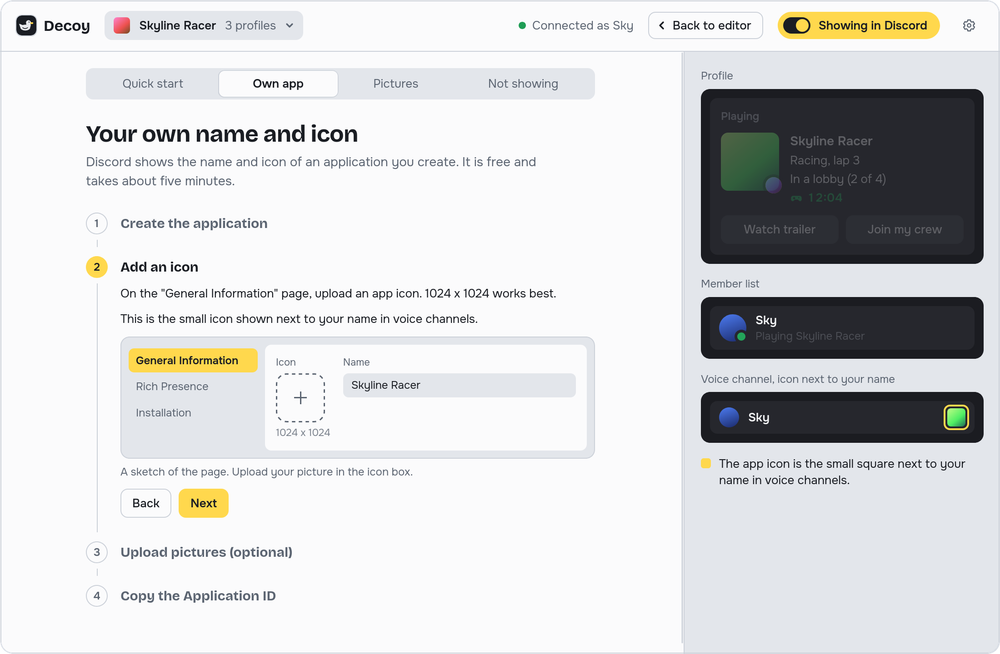

<p align="center">
  
</p>

<h1 align="center">Decoy</h1>

<p align="center">
  <b>Looks busy so you don't have to.</b><br>
  Custom Discord Rich Presence for Windows, macOS and Linux.
</p>

<p align="center">
  <a href="https://github.com/mountain-beaver/decoy/releases/latest"></a>
  <a href="https://github.com/mountain-beaver/decoy/actions/workflows/ci.yml"></a>
  <a href="LICENSE"></a>
</p>

<p align="center">
  <a href="#install">Install</a> ·
  <a href="#first-steps">First steps</a> ·
  <a href="#what-it-does">Features</a> ·
  <a href="#privacy">Privacy</a> ·
  <a href="#build-from-source">Build</a>
</p>

<p align="center">
  <picture>
    <source media="(prefers-color-scheme: dark)" srcset="docs/window-dark.png">
    
  </picture>
</p>

Pick any game Discord knows, or bring your own name and icon. Write the text, set a timer, flip one switch. Decoy then sits in the tray and stays out of the way.

## What your friends see

<p align="center">
  
</p>

These are fragments of a real Discord window, with the name and avatar covered. The small icon next to your name in a voice channel comes from the game you pick, so it looks exactly like the real thing.

## What it does

- **Any game, with its real name and icon.** Search Discord's own list of about 25,000 games.
- **Or your own application.** Paste an application ID from the Discord Developer Portal to use your own name, icon and uploaded images.
- **Everything Rich Presence can show.** Playing, Listening to, Watching or Competing in. Two lines of text, party size, a timer (since you turned it on, time of day, or a countdown), large and small images, up to two buttons, links on text and images.
- **A live preview** of your profile card, the member list and the voice channel row, updated as you type.
- **Profiles.** Keep several presences and switch between them from the tray. Export a profile to a file and import it on another computer.
- **Starts with your computer** and reconnects by itself whenever Discord restarts.
- **Small.** The installers are a few megabytes. On Linux the tray process uses about 3 MB of memory; the window exists only while you look at it.

## Install

Download the file for your system from the [Releases](https://github.com/mountain-beaver/decoy/releases/latest) page.

| System | File | First start |
|---|---|---|
| Windows 10 and 11 | `Decoy_x.y.z_x64-setup.exe` | Windows may show "Windows protected your PC". Press **More info**, then **Run anyway**. |
| macOS 10.15 or newer | `Decoy_x.y.z_universal.dmg` (Intel and Apple Silicon) | macOS says it cannot check the app. Open **System Settings**, **Privacy & Security**, scroll down and press **Open Anyway**. |
| Debian, Ubuntu, Mint | `Decoy_x.y.z_amd64.deb` | `sudo apt install ./Decoy_x.y.z_amd64.deb` |
| Fedora, openSUSE | `Decoy-x.y.z-1.x86_64.rpm` | `sudo dnf install ./Decoy-x.y.z-1.x86_64.rpm` |
| Any other Linux | `Decoy_x.y.z_amd64.AppImage` | `chmod +x` the file and run it. |

The warnings on Windows and macOS appear because the installers are not signed with a paid certificate. The builds are made by GitHub Actions from this repository, and you can [build your own](#build-from-source).

Discord has to be running on the same computer. On Linux, Decoy also works with Vesktop and other clients that provide the Discord IPC socket (arRPC). The tray icon on Linux needs a panel with StatusNotifierItem support, which KDE, Hyprland bars and most others have; GNOME needs the AppIndicator extension. Without a tray Decoy still works from its window.

## First steps

1. Start Decoy and pick a game from the list.
2. Fill in the text, timer, images and buttons. The preview on the right shows what others will see.
3. Switch on **Showing in Discord**.

Want your own name and icon instead of a game's? Press **Guide** in the top bar. It walks through the Discord Developer Portal step by step, shows where each field ends up, and lists what to check when nothing appears.

<p align="center">
  <picture>
    <source media="(prefers-color-scheme: dark)" srcset="docs/guide-dark.png">
    
  </picture>
</p>

## How it works

Decoy talks to the Discord client on your computer through Discord's local IPC socket, the same documented way games report what you are playing. It never asks for your password or token and does not touch your account.

Game names and icons are loaded from Discord's public API and CDN when you use the app.

## Privacy

Decoy has no account, no analytics and no server of its own. It makes these requests and no others:

- to `discord.com` and `cdn.discordapp.com`, for the public game list, the name and icon of an application ID you enter, and its uploaded images;
- to `api.github.com`, at most twice a day while the window is open, to see whether a newer version exists. It only reads the version number and shows a link; nothing is downloaded or installed by itself. Switch it off under **Settings**, **Check for updates**.

Your profiles are plain JSON files in the app's config folder on your computer.

## Things to know

- Discord does not let you click your own buttons. Other people can.
- Discord accepts about five presence updates every 20 seconds, so fast edits are sent in batches.
- A custom display name is sent to Discord, but some clients ignore it and show the application's name.
- Text limits are counted the way Discord counts them, so an emoji takes two of the 128 characters.

## Build from source

You need Rust, Node.js with pnpm, and the [Tauri 2 prerequisites](https://v2.tauri.app/start/prerequisites/) for your system.

```sh
pnpm install
pnpm tauri build
```

With Nix, run `nix develop` and build with `cargo tauri build` instead.

<details>
<summary>Project layout, checks and Linux notes</summary>

| Path | What it is |
|---|---|
| `crates/decoy-core` | Discord IPC client, presence model, profiles, game list. Pure Rust, no GUI. |
| `crates/decoy-app` | App logic shared by the tray daemon and the window. |
| `crates/decoy-daemon` | Linux only: the small process that sits in the tray. |
| `src-tauri` | The desktop shell (Tauri 2). |
| `src` | The window (Svelte). |

On Linux the tray icon and the Discord connection live in a small separate process, and the window is started only when you open it. In the tray that process uses about 3 MB of memory; the window adds about 200 MB while it is open and gives it all back when closed. On Windows and macOS the window's webview is likewise destroyed when you close it.

```sh
cargo test --workspace          # unit and integration tests, with a fake Discord
cargo clippy --workspace --all-targets -- -D warnings
pnpm check                      # types of the window code
scripts/smoke.sh <path to the built decoy binary> smoke-out
```

`scripts/smoke.sh` starts the real app with a sample profile, waits for the window to render, presses a few controls and writes a report and a screenshot. The CI workflow runs all of the above on Linux, Windows and macOS.

On Linux the window follows your monitor's refresh rate. WebKitGTK falls back to 60 fps when the graphics driver refuses its vertical-blank wait (NVIDIA's proprietary driver does), so Decoy paces frames itself in that case and uses the non-dmabuf renderer on NVIDIA. `DECOY_VBLANK=off` and `WEBKIT_DISABLE_DMABUF_RENDERER=0` switch these back.

</details>

## License

MIT. See [LICENSE](LICENSE).

Decoy is not affiliated with Discord or any game publisher. Game names and icons, including the ones in the screenshots above, belong to their owners.
