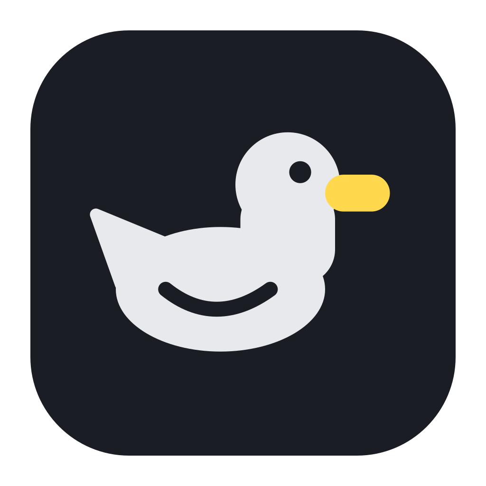

<a href="../README.md">English</a> · <a href="README.ru.md">Русский</a> · <a href="README.pt-BR.md">Português</a> · <a href="README.es.md">Español</a> · <a href="README.fr.md">Français</a> · <b>Deutsch</b>

  

<h1 align="center">Decoy</h1>

  <b>Zeig als Discord-Status, was du willst.</b> 
  Ein Spiel, das du gar nicht spielst, einen Button, der zu deinem Server führt, deinen Stream, dein eigenes Bild und deinen eigenen Text. 
  Kostenlos und klein. Kein Konto, kein Passwort, kein Programmieren.

  
  &nbsp;
  
  &nbsp;
  

  Windows 10 und 11, macOS 10.15 oder neuer, die meisten Linux-Systeme. <a href="#install">Hilfe zur Installation und weitere Dateien</a>

  <picture>
    <source media="(prefers-color-scheme: dark)" srcset="window-dark.png">
    
  </picture>

Decoy ist eine kostenlose Open-Source-App für eigene Discord Rich Presence. Sie setzt deinen Discord-Aktivitätsstatus (die Zeile „Spielt …“ unter deinem Namen) auf ein beliebiges Spiel oder auf deinen eigenen Namen, Text, Bilder und Buttons. Wenn du CustomRP für Windows kennst: Decoy macht dasselbe und läuft außerdem auf Mac und Linux.

## Was deine Freunde sehen

  

Das sind Ausschnitte aus einem echten Discord-Fenster, Name und Avatar sind ausgeblendet. Dein Status erscheint in deinem Profil, in der Mitgliederliste und als kleines Symbol neben deinem Namen in Sprachkanälen.

## Wofür man es benutzt

  

- **Beschäftigt wirken.** Such dir eines von rund 25.000 Spielen aus, die Discord kennt. Dein Status sieht genau so aus, als würdest du es spielen.
- **Leute auf deinen Server einladen.** Setz einen Button auf dein Profil, der deinen Einladungslink öffnet. [So geht's](#add-a-link-to-your-server).
- **Zeigen, was du magst.** Ein Stream, eine Playlist, ein YouTube-Kanal, deine Website: Jeder Link kann ein Button sein.
- **Mach es zu deinem eigenen.** Dein eigener Name, dein Bild und dein Text statt eines Spiels. Eine Anleitung in Decoy zeigt dir Schritt für Schritt, wie das geht.

## Los geht's

1. **Lade Decoy herunter** mit einem der Buttons oben und öffne es. Beim ersten Mal fragt Windows oder macOS vielleicht, ob du der App vertraust: [was du drücken musst](#install).
2. **Such ein Spiel aus.** Fang an, den Namen zu tippen, und wähl es aus der Liste.
3. **Schreib deinen Text**, wenn du magst: zwei Zeilen, einen Timer, einen Button. Die Vorschau rechts zeigt, was die anderen sehen werden.
4. **Schalte „Showing in Discord“** (**Showing in Discord** heißt „In Discord anzeigen“) oben rechts ein. Das war's.

Discord muss auf demselben Computer geöffnet sein (die App, nicht die Website). Du kannst das Decoy-Fenster schließen: Es läuft im Tray weiter, neben der Uhr.

## Einen Link zu deinem Server hinzufügen

  <picture>
    <source media="(prefers-color-scheme: dark)" srcset="buttons-dark.png">
    
  </picture>

1. Öffne in Discord deinen Server, klick oben auf seinen Namen und wähl **Leute einladen**. Klick auf **Edit invite link** (Einladungslink bearbeiten), stell ein, dass er nie abläuft, und kopier den Link.
2. Scroll in Decoy nach unten zu **Buttons** und drück auf **Add button** (Button hinzufügen).
3. Schreib bei **Label** (Beschriftung), was auf dem Button stehen soll, zum Beispiel `Tritt meinem Server bei`. Füg bei **Link** deine Einladung ein.
4. Achte darauf, dass **Showing in Discord** eingeschaltet ist.

Gut zu wissen:

- Du kannst nicht auf deinen eigenen Button klicken. Discord lässt nur andere Leute darauf klicken, also bitte einen Freund, es zu testen.
- Du kannst zwei Buttons haben. Jeder Link, der mit `https://` beginnt, funktioniert: eine Server-Einladung, Twitch, YouTube, deine Website.
- Du willst statt eines Spiels den Namen und das Logo deines Servers? Drück in Decoy auf **Guide** (Anleitung) und dann auf **Own app** (eigene App). Das ist kostenlos und dauert etwa fünf Minuten.

## Installation

| Dein Computer | Download | Beim ersten Öffnen |
|---|---|---|
| Windows 10 und 11 | [.exe herunterladen](https://github.com/mountain-beaver/decoy/releases/latest/download/Decoy-windows-x64-setup.exe) | Windows zeigt vielleicht „Der Computer wurde durch Windows geschützt“. Drück auf **Weitere Informationen** und dann auf **Trotzdem ausführen**. |
| Mac (Intel und Apple Silicon) | [.dmg herunterladen](https://github.com/mountain-beaver/decoy/releases/latest/download/Decoy-darwin-universal.dmg) | Zieh Decoy in den Ordner Programme. Wenn macOS sagt, dass es die App nicht prüfen kann, öffne **Systemeinstellungen**, **Datenschutz & Sicherheit**, scroll nach unten und drück auf **Trotzdem öffnen**. |
| Linux, beliebig | [.AppImage herunterladen](https://github.com/mountain-beaver/decoy/releases/latest/download/Decoy-linux-amd64.AppImage) | Erlaub der Datei, ausgeführt zu werden (`chmod +x`), und öffne sie dann. |
| Debian, Ubuntu, Mint | [.deb herunterladen](https://github.com/mountain-beaver/decoy/releases/latest/download/Decoy-linux-amd64.deb) | `sudo apt install ./Decoy-linux-amd64.deb` |
| Fedora, openSUSE | [.rpm herunterladen](https://github.com/mountain-beaver/decoy/releases/latest/download/Decoy-linux-x86_64.rpm) | `sudo dnf install ./Decoy-linux-x86_64.rpm` |

**Warum zeigen Windows und macOS eine Warnung?** Sie warnen bei jeder App, deren Entwickler kein Zertifikat von Microsoft oder Apple bezahlt hat, und Decoy ist ein kostenloses Projekt, das keins bezahlt hat. Die Installationsdateien werden automatisch aus dem Code in diesem Repository gebaut, den jeder lesen kann.

Alle Versionen findest du auf der Seite [Releases](https://github.com/mountain-beaver/decoy/releases).

## Fragen

**Ist es kostenlos?** 
Ja. Keine Werbung, keine Bezahlversion.

**Ist es sicher für mein Konto?** 
Decoy fragt nie nach deinem Discord-Passwort und meldet sich nicht in deinem Konto an. Es sagt der Discord-App auf deinem Computer nur, was sie anzeigen soll, genau wie Spiele das tun.

**Muss ich es offen lassen?** 
Decoy muss laufen, aber du kannst sein Fenster schließen: Es bleibt im Tray. Damit es zusammen mit deinem Computer startet, öffne **Settings** (Einstellungen, das Zahnrad) und schalte **Start with my computer** (mit meinem Computer starten) ein.

**Geht es auf dem Handy oder im Browser?** 
Decoy läuft auf einem Computer, neben der Discord-Desktop-App. Leute am Handy sehen deinen Status trotzdem.

**In Discord erscheint nichts. Was prüfe ich?**
1. Die Discord-Desktop-App läuft auf demselben Computer.
2. In Discord unter **Benutzereinstellungen**, **Activity Privacy** (Aktivitätsprivatsphäre): Das Teilen deiner Aktivität ist eingeschaltet.
3. Dein Status ist nicht auf **Unsichtbar** gestellt.

In Decoy gibt es eine längere Checkliste: **Guide**, dann **Not showing** (wird nicht angezeigt).

**Kann ich mehr als einen Status haben?** 
Ja. Leg mehrere Profile an und wechsel zwischen ihnen im Fenster oder über das Tray-Symbol.

**Kann ich den Namen nach „Spielt“ ändern?** 
Ja, mit deiner eigenen Anwendung: **Guide**, dann **Own app**.

## Datenschutz

Decoy hat kein Konto, keine Analyse und keinen eigenen Server. Deine Profile werden nur auf deinem Computer gespeichert.

Es verbindet sich aus zwei Gründen mit dem Internet: mit Discord, um die Spieleliste, Namen und Bilder zu laden, und mit GitHub, höchstens zweimal am Tag, um nachzusehen, ob es eine neuere Version gibt. Es zeigt dir nur einen Link und lädt nie von selbst etwas herunter. Diese Prüfung kannst du unter **Settings** ausschalten.

## Gefällt es dir?

Gib dem Repository oben auf dieser Seite einen Stern. Das kostet nichts und hilft anderen, Decoy zu finden. Einen Fehler gefunden oder eine Idee? [Sag es mir hier](https://github.com/mountain-beaver/decoy/issues/new/choose), technische Details brauchst du nicht.

## Für Entwickler

Decoy ist Open Source unter der [MIT-Lizenz](../LICENSE). Wie es innen funktioniert, wie man es baut und wie man die Prüfungen laufen lässt: [DEVELOPMENT.md](DEVELOPMENT.md).

Decoy steht in keiner Verbindung zu Discord oder zu irgendeinem Spielepublisher. Spielenamen und Symbole, auch die in den Bildern oben, gehören ihren Eigentümern.
