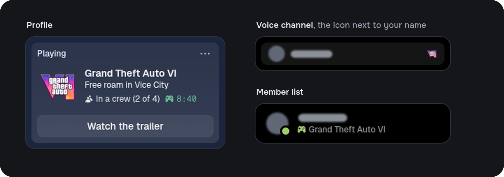
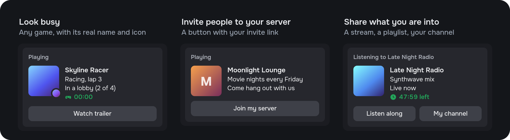

<a href="../README.md">English</a> · <a href="README.ru.md">Русский</a> · <b>Português</b> · <a href="README.es.md">Español</a> · <a href="README.fr.md">Français</a> · <a href="README.de.md">Deutsch</a>

  

<h1 align="center">Decoy</h1>

  <b>Mostre o que você quiser como status no Discord.</b> 
  Um jogo que você não está jogando, um botão que leva ao seu servidor, a sua live, a sua própria imagem e o seu texto. 
  Grátis e leve. Sem conta, sem senha, sem programar.

  
  &nbsp;
  
  &nbsp;
  

  Windows 10 e 11, macOS 10.15 ou mais novo, a maioria dos sistemas Linux. <a href="#install">Ajuda para instalar e outros arquivos</a>

  <picture>
    <source media="(prefers-color-scheme: dark)" srcset="window-dark.png">
    
  </picture>

O Decoy é um app gratuito e de código aberto para o Rich Presence personalizado do Discord. Ele define o seu status de atividade no Discord (a linha "Jogando…" embaixo do seu nome) com qualquer jogo, ou com o seu próprio nome, texto, imagens e botões. Se você conhece o CustomRP para Windows, o Decoy faz o mesmo trabalho e ainda roda no Mac e no Linux.

## O que os seus amigos veem

  

Estes são pedaços de uma janela real do Discord, com o nome e o avatar escondidos. O seu status aparece no seu perfil, na lista de membros e como um ícone pequeno ao lado do seu nome nos canais de voz.

## Para que as pessoas usam

  

- **Parecer ocupado.** Escolha entre cerca de 25.000 jogos que o Discord conhece. O seu status fica igualzinho a como se você estivesse jogando.
- **Convidar pessoas para o seu servidor.** Coloque no seu perfil um botão que abre o seu link de convite. [Veja como](#add-a-link-to-your-server).
- **Mostrar do que você gosta.** Uma live, uma playlist, um canal do YouTube, o seu site: qualquer link pode virar um botão.
- **Deixar com a sua cara.** O seu próprio nome, imagem e texto no lugar de um jogo. Um guia dentro do Decoy mostra como, passo a passo.

## Primeiros passos

1. **Baixe o Decoy** com um dos botões acima e abra o app. Na primeira vez, o Windows ou o macOS podem perguntar se você confia nele: [o que apertar](#install).
2. **Escolha um jogo.** Comece a digitar o nome e escolha na lista.
3. **Escreva o seu texto**, se quiser: duas linhas, um cronômetro, um botão. A prévia à direita mostra o que os outros vão ver.
4. **Ligue a opção "Showing in Discord"** (**Showing in Discord** quer dizer "Aparecendo no Discord") no canto superior direito. Pronto.

O Discord precisa estar aberto no mesmo computador (o app, não o site). Você pode fechar a janela do Decoy: ele continua rodando na bandeja, perto do relógio.

## Adicione um link do seu servidor

  <picture>
    <source media="(prefers-color-scheme: dark)" srcset="buttons-dark.png">
    
  </picture>

1. No Discord, abra o seu servidor, clique no nome dele lá em cima e escolha **Convidar pessoas**. Clique em **Edit invite link** (editar link de convite), deixe o link sem data para expirar e copie o link.
2. No Decoy, role para baixo até **Buttons** (botões) e aperte **Add button** (adicionar botão).
3. Em **Label** (texto do botão), escreva o que o botão deve dizer, por exemplo `Entre no meu servidor`. Em **Link**, cole o seu convite.
4. Confira se **Showing in Discord** está ligado.

Bom saber:

- Você não consegue clicar no seu próprio botão. O Discord só deixa outras pessoas clicarem, então peça para um amigo testar.
- Você pode ter dois botões. Qualquer link que comece com `https://` funciona: convite de servidor, Twitch, YouTube, o seu site.
- Quer o nome e o logo do seu servidor no lugar de um jogo? Aperte **Guide** (guia) no Decoy e depois **Own app** (app próprio). É grátis e leva uns cinco minutos.

## Instalação

| O seu computador | Baixar | Na primeira vez que você abrir |
|---|---|---|
| Windows 10 e 11 | [Baixar .exe](https://github.com/mountain-beaver/decoy/releases/latest/download/Decoy-windows-x64-setup.exe) | O Windows pode mostrar "O Windows protegeu o computador". Clique em **Mais informações** e depois em **Executar assim mesmo**. |
| Mac (Intel e Apple Silicon) | [Baixar .dmg](https://github.com/mountain-beaver/decoy/releases/latest/download/Decoy-darwin-universal.dmg) | Arraste o Decoy para a pasta Aplicativos. Se o macOS disser que não consegue verificar o app, abra **Ajustes do Sistema**, **Privacidade e Segurança**, role para baixo e clique em **Abrir Mesmo Assim**. |
| Linux, qualquer um | [Baixar .AppImage](https://github.com/mountain-beaver/decoy/releases/latest/download/Decoy-linux-amd64.AppImage) | Permita que o arquivo seja executado (`chmod +x`) e depois abra. |
| Debian, Ubuntu, Mint | [Baixar .deb](https://github.com/mountain-beaver/decoy/releases/latest/download/Decoy-linux-amd64.deb) | `sudo apt install ./Decoy-linux-amd64.deb` |
| Fedora, openSUSE | [Baixar .rpm](https://github.com/mountain-beaver/decoy/releases/latest/download/Decoy-linux-x86_64.rpm) | `sudo dnf install ./Decoy-linux-x86_64.rpm` |

**Por que o Windows e o macOS mostram um aviso?** Eles avisam sobre todo app cujo criador não pagou um certificado à Microsoft ou à Apple, e o Decoy é um projeto gratuito que não pagou. Os instaladores são montados automaticamente a partir do código deste repositório, que qualquer pessoa pode ler.

Todas as versões estão na página de [Releases](https://github.com/mountain-beaver/decoy/releases).

## Perguntas

**É grátis?** 
É. Sem anúncios, sem versão paga.

**É seguro para a minha conta?** 
O Decoy nunca pede a sua senha do Discord e não entra na sua conta. Ele só diz ao app do Discord no seu computador o que mostrar, do mesmo jeito que os jogos fazem.

**Preciso deixar o app aberto?** 
O Decoy precisa estar rodando, mas você pode fechar a janela dele: ele fica na bandeja. Para ele abrir junto com o computador, abra **Settings** (configurações, a engrenagem) e ligue **Start with my computer** (iniciar com o meu computador).

**Funciona no celular ou no navegador?** 
O Decoy roda em um computador, ao lado do app do Discord para desktop. Quem está no celular vai ver o seu status do mesmo jeito.

**Nada aparece no Discord. O que eu confiro?**
1. O app do Discord para desktop está rodando no mesmo computador.
2. No Discord, em **Configurações de usuário**, **Activity Privacy** (privacidade de atividade): o compartilhamento da sua atividade está ligado.
3. O seu status não está como **Invisível**.

Existe uma lista de checagem mais longa dentro do Decoy: **Guide** e depois **Not showing** (não está aparecendo).

**Posso ter mais de um status?** 
Pode. Crie vários perfis e troque entre eles na janela ou pelo ícone da bandeja.

**Posso mudar o nome depois de "Jogando"?** 
Pode, com o seu próprio aplicativo: **Guide** e depois **Own app**.

## Privacidade

O Decoy não tem conta, não tem análise de uso e não tem servidor próprio. Os seus perfis ficam salvos só no seu computador.

Ele se conecta à internet por dois motivos: ao Discord, para carregar a lista de jogos, os nomes e as imagens, e ao GitHub, no máximo duas vezes por dia, para ver se existe uma versão mais nova. Ele só mostra um link para você e nunca baixa nada sozinho. Você pode desligar essa verificação em **Settings**.

## Gostou?

Dê uma estrela ao repositório lá em cima nesta página. Não custa nada e ajuda outras pessoas a encontrar o Decoy. Achou um bug ou tem uma ideia? [Conte aqui](https://github.com/mountain-beaver/decoy/issues/new/choose), sem precisar de detalhes técnicos.

## Para desenvolvedores

O Decoy é de código aberto sob a [licença MIT](../LICENSE). Como ele funciona por dentro, como compilar e como rodar as verificações: [DEVELOPMENT.md](DEVELOPMENT.md).

O Decoy não tem relação com o Discord nem com nenhuma publicadora de jogos. Os nomes e ícones dos jogos, inclusive os das imagens acima, pertencem aos seus donos.
